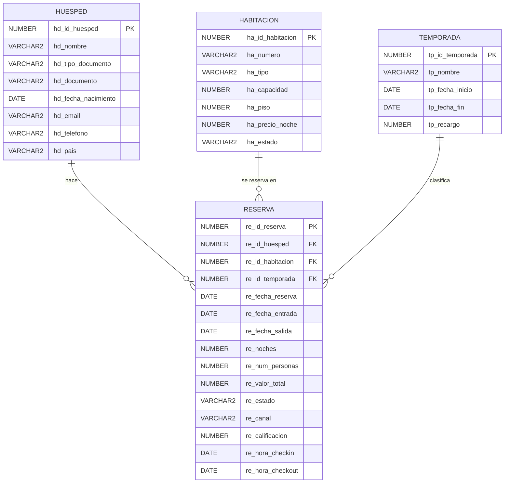

# Celosía: base de datos y app de un hotel

> *La brisa entra, el ruido se queda afuera.*

Celosía es un hotel boutique **inventado** en Cartagena de Indias. Tiene 23 habitaciones en 7 pisos.

Este proyecto tiene dos partes:

1. **Una base de datos en Oracle** donde se guardan los huéspedes, las habitaciones, las temporadas y las reservas.
2. **Una app hecha en Python con Streamlit** para hacer reservas, registrar la llegada y salida de los huéspedes, y analizar cómo le va al hotel.

Proyecto del curso Introducción a Business Intelligence, EAFIT. Autora: **Sara Henao Fernández**.

---

## Archivos

| Archivo | Qué es |
|---|---|
| `DDL_hotel.sql` | Crea las 4 tablas y sus reglas. Se ejecuta primero |
| `DML_hotel.sql` | Llena las tablas con datos de prueba. Se ejecuta después del DDL |
| `main.py` | Arranca la app: navegación y manejo general de errores |
| `config.py` | Datos del hotel, colores y parámetros de negocio |
| `conexion.py` | Conexión a Oracle en un solo lugar: lecturas, escrituras y mensajes de error |
| `interfaz.py` | Piezas visuales que comparten las páginas: tablas, gráficos, exportación a Excel |
| `reglas.py` | Reglas de negocio que revisa la app: edad, formato del documento, check-in y check-out |
| `paginas/` | Una página de la app por archivo |
| `requirements.txt` | Librerías de Python necesarias |
| `README.md` | Este documento |

---

## Las tablas

La base tiene **4 tablas** organizadas en **estrella**:

- En el centro está **`reserva`**: cada fila es una habitación reservada por un huésped para una estadía.
- Alrededor hay tres tablas que describen cada reserva:
  - **`huesped`**: quién reserva.
  - **`habitacion`**: qué se reserva.
  - **`temporada`**: en qué época del año.

Un huésped, una habitación o una temporada pueden aparecer en **muchas** reservas, pero cada reserva tiene **solo uno** de cada uno. Por eso las relaciones son **1 a N**.



---

## Normalización

### ¿Qué es normalizar?

Normalizar es organizar las tablas para que **cada dato se guarde en un solo lugar**. Así, si un dato cambia, solo hay que corregirlo una vez, y la base nunca dice dos cosas distintas sobre lo mismo.

Un ejemplo de lo que se evita: si el precio de la habitación 402 se escribiera en cada una de sus reservas, al subir la tarifa habría que cambiarlo en cientos de filas. Si se olvida alguna, la base tendría dos precios distintos para la misma habitación. Por eso el precio vive **solo** en la tabla `habitacion`.

Hay varios niveles de normalización, llamados **formas normales**. Cada uno agrega una regla al anterior. Las tablas de este proyecto cumplen las tres primeras.

### Primera forma normal (1FN): una sola cosa por casilla

**La regla:** en cada casilla de la tabla va un solo dato, nunca una lista.

**En este proyecto:**
- Cada huésped tiene **un** teléfono, **un** email y **un** documento. No hay casillas como "300 123 4567, 310 987 6543".
- Una reserva es **una** habitación. Si una familia toma dos habitaciones, se guardan como dos reservas, en dos filas, y no como "402 y 403" en una misma casilla.

### Segunda forma normal (2FN): cada dato depende de toda la llave

**La regla:** cada dato debe depender de la llave completa de la tabla, y no solo de una parte de ella.

**En este proyecto:** esta regla solo puede romperse cuando la llave de una tabla está formada por **dos o más columnas**. Aquí, todas las llaves son **de una sola columna**: un código para cada huésped, cada habitación, cada temporada y cada reserva. Por eso esta forma se cumple automáticamente.

### Tercera forma normal (3FN): cada dato está en la tabla que le corresponde

**La regla:** un dato debe depender de lo que la tabla describe, y no de otro dato de la misma tabla.

**En este proyecto:**
- El **precio por noche** está en `habitacion`, porque cada habitación tiene su propio precio: la suite 402 y la suite 602 cuestan distinto.
- El **recargo** está en `temporada`, porque depende de la época del año.
- El **país** está en `huesped`, porque es un dato de la persona.
- La tabla `reserva` **no repite** ninguno de esos datos: solo guarda los códigos que la conectan con el huésped, la habitación y la temporada.

### Lo que no se guarda porque se puede calcular

- **La edad del huésped:** cambia cada año. Se guarda la fecha de nacimiento y la edad se calcula cuando se necesita.
- **Si una habitación está libre u ocupada:** cambia según la fecha. Se calcula revisando las reservas. La columna `ha_estado` solo dice si la habitación está en servicio o en mantenimiento.

### Tres excepciones hechas a propósito

En `reserva` hay tres datos que se podrían calcular a partir de otros. Una normalización estricta diría que no deberían guardarse, pero aquí se guardan por buenas razones, y es lo habitual en la tabla principal de un modelo estrella:

| Dato | Se podría calcular con | Por qué se guarda de todas formas | Qué evita errores |
|---|---|---|---|
| `re_noches` | La fecha de salida menos la de entrada | Se usa en casi todos los análisis, y así no hay que calcularlo cada vez | Una regla de la base exige que coincida con las fechas |
| `re_valor_total` | Precio × noches × recargo | Es lo que se cobró **en el momento de reservar**. Si mañana sube la tarifa, la reserva debe seguir mostrando lo que realmente se pagó | La app lo calcula al reservar o modificar |
| `re_id_temporada` | La fecha de entrada | Conecta la reserva con su temporada de forma directa | La app lo asigna según la fecha de entrada |

---

## Las reglas

La base de datos no deja guardar datos que no tengan sentido. Algunos ejemplos:

- No se pueden registrar dos huéspedes con el mismo tipo y número de documento.
- Una cédula solo tiene números; un pasaporte tiene letras y números.
- Una habitación tiene capacidad para 1 a 6 personas.
- La fecha de salida debe ser posterior a la de entrada.
- Las noches deben coincidir con las fechas.
- Una reserva solo puede tener calificación si ya terminó.

Hay reglas que la base **no puede** revisar sola, porque necesitan mirar otra tabla, otras reservas o la fecha de hoy. Esas las revisa la app antes de guardar:

- Las personas caben en la habitación.
- La habitación está libre en esas fechas.
- La temporada corresponde a la fecha de entrada.
- El valor se calcula así: precio por noche × noches × (1 + recargo de la temporada).
- El huésped es mayor de edad.

Una reserva pasa por estos estados:

```
confirmada  →  en_curso (llegó el huésped)  →  finalizada (se fue)
confirmada  →  cancelada
```

---

## Cómo está hecho el código

- **Modular:** cada archivo tiene una sola responsabilidad (conexión, reglas, interfaz) y cada página de la app vive en su propio archivo dentro de `paginas/`.
- **Conexión centralizada:** solo `conexion.py` habla con Oracle. Crea un pool de conexiones una vez y el resto del código usa sus funciones `consultar()`, `valor()` y `escribir()`.
- **Consultas parametrizadas:** ninguna consulta se arma pegando texto. Todos los valores viajan como variables bind (`:documento`, `:fecha`…), así que la app no es vulnerable a inyección SQL. Los filtros opcionales también son variables bind: si están vacíos se envían como `NULL` y no filtran nada.
- **Manejo de excepciones:** cada escritura va dentro de una transacción con `COMMIT` o `ROLLBACK`. Los errores de Oracle se traducen a mensajes claros, por ejemplo *"No se puede eliminar: hay reservas que dependen de este registro"*, y `main.py` atrapa cualquier error que no se haya manejado en una página.
- **Credenciales fuera del código:** el usuario, las contraseñas y el wallet se leen de `.streamlit/secrets.toml`, que no está en el repositorio.
- **Consultas SQL de solo lectura:** la página de consultas libres solo acepta `SELECT` y lo ejecuta en una transacción de solo lectura.

---

## Los datos de prueba

| Tabla | Registros |
|---|---|
| huesped | 1.281 |
| habitacion | 23 |
| temporada | 14 |
| reserva | 2.087 |

Los datos son inventados, pero se comportan como los de un hotel real: hay más ocupación en diciembre y Semana Santa, las suites se venden menos que las habitaciones dobles, las familiares se llenan en vacaciones, hay huéspedes de 19 países, cancelaciones, y llegadas a distintas horas del día. Van de enero de 2025 a febrero de 2027, y los estados de las reservas están calculados al 10 de noviembre de 2026.

---

## Cómo usarlo

### 1. Crear la base de datos

1. Crea una base **Oracle Autonomous Database** gratuita (Always Free) y descarga su **wallet**.
2. Abre SQL Developer y conéctate a la base con el wallet.
3. Abre `DDL_hotel.sql` y ejecútalo con **F5**. Se crean las 4 tablas.
4. Abre `DML_hotel.sql` y ejecútalo con **F5**. Se cargan los datos (tarda de 1 a 3 minutos).

### 2. Correr la app

1. Instala las librerías en la terminal, desde la carpeta del proyecto:
   ```
   pip install -r requirements.txt
   ```
   Son: `streamlit`, `oracledb`, `pandas`, `altair` y `openpyxl`.
2. Descomprime el wallet en una carpeta, por ejemplo `C:/oracle/wallet_hotel/wallet`.
3. Junto a `main.py`, crea una carpeta llamada `.streamlit` y, dentro, un archivo `secrets.toml` con tus datos:
   ```toml
   [oracle]
   user = "ADMIN"
   password = "tu_contraseña_de_la_base"
   dsn = "adbhotel_low"
   config_dir = "C:/oracle/wallet_hotel/wallet"
   wallet_password = "tu_contraseña_del_wallet"
   ```
   **Este archivo tiene tus contraseñas: no lo subas a GitHub.**
4. Corre la app:
   ```
   streamlit run main.py
   ```

---

## Qué se puede hacer en la app

**Recepción**
- **Resumen del día:** ver cómo está el hotel cualquier día, piso por piso, y hacer el **check-in** y el **check-out** de los huéspedes de hoy.
- **Nueva reserva:** buscar al huésped, elegir fechas y ver solo las habitaciones disponibles. La app calcula el precio.
- **Reservas:** buscar, cancelar o modificar reservas, y calificar las estadías.
- **Huéspedes:** registrar huéspedes nuevos, ver su historial y eliminar los que no tienen reservas.

**Hotel**
- **Mapa de ocupación:** qué habitaciones están ocupadas cada día del mes.
- **Habitaciones:** pasar una habitación a mantenimiento o volver a activarla.
- **Temporadas:** crear temporadas nuevas y eliminar las que no tienen reservas.

**Análisis**
- **Desempeño:** ocupación, ingresos, canales de venta, con cuánta anticipación reservan, cómo va un mes comparado con el año pasado, y a qué hora llegan y salen los huéspedes.
- **Clientes:** satisfacción, huéspedes más frecuentes, cancelaciones y países de origen.
- **Consultas SQL:** escribir consultas propias de solo lectura.

Las tablas se pueden **descargar en Excel**.
