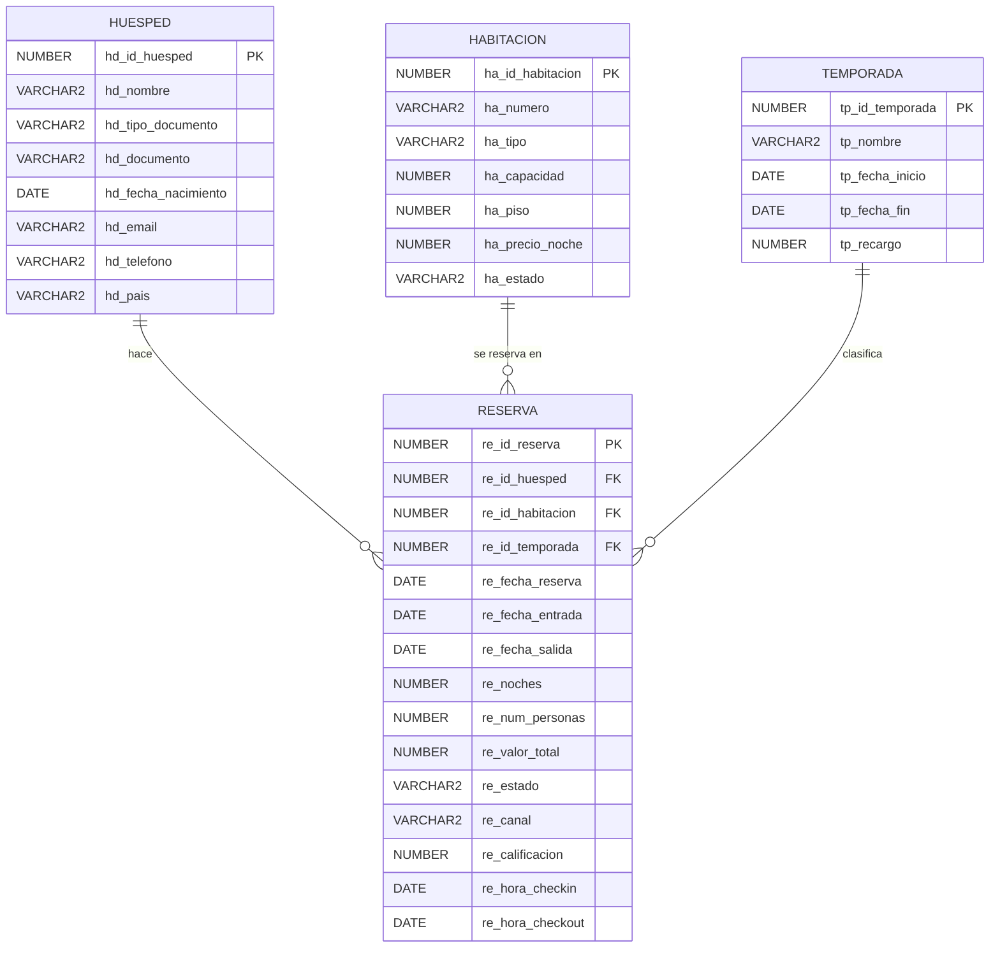

# Celosía: base de datos y app de un hotel

> *La brisa entra, el ruido se queda afuera.*

Celosía es un hotel boutique **inventado** en Cartagena de Indias. Tiene 23 habitaciones en 7 pisos.

Este proyecto tiene dos partes:

1. **Una base de datos en Oracle** donde se guardan los huéspedes, las habitaciones, las temporadas y las reservas.
2. **Una app hecha en Python con Streamlit** para hacer reservas, registrar la llegada y salida de los huéspedes, y analizar cómo le va al hotel.

Proyecto del curso Introducción a Business Intelligence, EAFIT. Autora: **Sara Henao Fernández**.

---

## Archivos

| Archivo | Qué es |
|---|---|
| `DDL_hotel.sql` | Crea las 4 tablas y sus reglas |
| `DML_hotel.sql` | Llena las tablas con datos de prueba |
| `main.py` | La app |
| `README.md` | Este documento |

---

## Las tablas

La base tiene **4 tablas** organizadas en **estrella**:

- En el centro está **`reserva`**: cada fila es una habitación reservada por un huésped para una estadía.
- Alrededor hay tres tablas que describen cada reserva:
  - **`huesped`**: quién reserva.
  - **`habitacion`**: qué se reserva.
  - **`temporada`**: en qué época del año.

Un huésped, una habitación o una temporada pueden aparecer en **muchas** reservas, pero cada reserva tiene **solo uno** de cada uno. Por eso las relaciones son **1 a N**.



---

## Las reglas

La base de datos no deja guardar datos que no tengan sentido. Algunos ejemplos:

- No se pueden registrar dos huéspedes con el mismo tipo y número de documento.
- Una cédula solo tiene números; un pasaporte tiene letras y números.
- Una habitación tiene capacidad para 1 a 6 personas.
- La fecha de salida debe ser posterior a la de entrada.
- Las noches deben coincidir con las fechas.
- Una reserva solo puede tener calificación si ya terminó.

Hay reglas que la base **no puede** revisar sola, porque necesitan mirar otra tabla, otras reservas o la fecha de hoy. Esas las revisa la app antes de guardar:

- Las personas caben en la habitación.
- La habitación está libre en esas fechas.
- La temporada corresponde a la fecha de entrada.
- El valor se calcula así: precio por noche × noches × (1 + recargo de la temporada).
- El huésped **que reserva** es mayor de edad.

Una reserva pasa por estos estados:

```
confirmada  →  en_curso (llegó el huésped)  →  finalizada (se fue)
confirmada  →  cancelada
```

---

## Los datos de prueba

| Tabla | Registros |
|---|---|
| huesped | 1.281 |
| habitacion | 23 |
| temporada | 14 |
| reserva | 2.087 |

Los datos son inventados, pero se comportan como los de un hotel real: hay más ocupación en diciembre y Semana Santa, las suites se venden menos que las habitaciones dobles, las familiares se llenan en vacaciones, hay huéspedes de 19 países, cancelaciones, y llegadas a distintas horas del día. Van de enero de 2025 a febrero de 2027, y los estados de las reservas están calculados al 10 de noviembre de 2026.

---

## Cómo usarlo

### 1. Crear la base de datos

1. Crea una base **Oracle Autonomous Database** gratuita (Always Free) y descarga su **wallet**.
2. Abre SQL Developer y conéctate a la base con el wallet.
3. Abre `DDL_hotel.sql` y ejecútalo. Se crean las 4 tablas.
4. Abre `DML_hotel.sql` y ejecútalo. Se cargan los datos.

### 2. Correr la app

1. Instala las librerías en la terminal:
   ```
   pip install streamlit oracledb pandas altair openpyxl
   ```
2. Descomprime el wallet en una carpeta, por ejemplo `C:/oracle/wallet_hotel/wallet`.
3. Junto a `main.py`, crea una carpeta llamada `.streamlit` y, dentro, un archivo `secrets.toml` con tus datos:
   ```toml
   [oracle]
   user = "ADMIN"
   password = "tu_contraseña_de_la_base"
   dsn = "adbhotel_low"
   config_dir = "C:/oracle/wallet_hotel/wallet"
   wallet_password = "tu_contraseña_del_wallet"
   ```
   **Este archivo tiene tus contraseñas: no lo subas a GitHub.**
4. Corre la app:
   ```
   streamlit run main.py
   ```

---

## Qué se puede hacer en la app

**Recepción**
- **Resumen del día:** ver cómo está el hotel cualquier día, piso por piso, y hacer el **check-in** y el **check-out** de los huéspedes de hoy.
- **Nueva reserva:** buscar al huésped, elegir fechas y ver solo las habitaciones disponibles. La app calcula el precio.
- **Reservas:** buscar, cancelar o modificar reservas, y calificar las estadías.
- **Huéspedes:** registrar huéspedes nuevos y ver su historial.

**Hotel**
- **Mapa de ocupación:** qué habitaciones están ocupadas cada día del mes.
- **Habitaciones:** pasar una habitación a mantenimiento o volver a activarla.
- **Temporadas:** crear temporadas nuevas.

**Análisis**
- **Desempeño:** ocupación, ingresos, canales de venta, con cuánta anticipación reservan, cómo va un mes comparado con el año pasado, y a qué hora llegan y salen los huéspedes.
- **Clientes:** satisfacción, huéspedes más frecuentes, cancelaciones y países de origen.
- **Consultas SQL:** escribir consultas propias.

Las tablas se pueden **descargar en Excel**.
