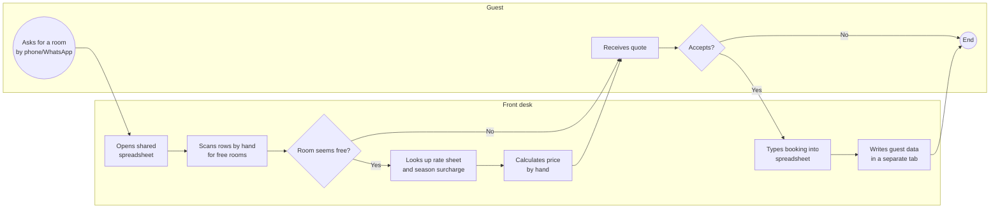
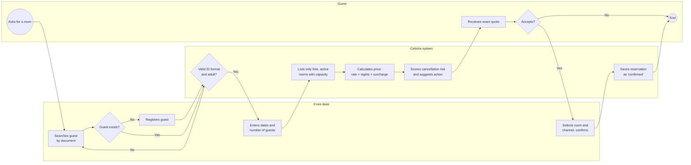
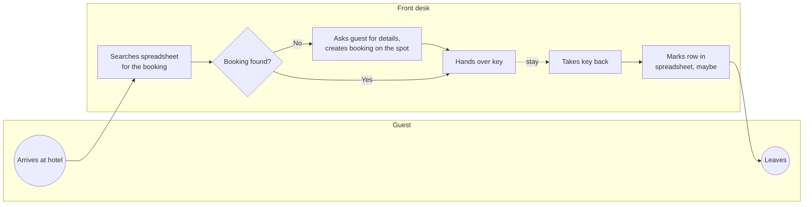
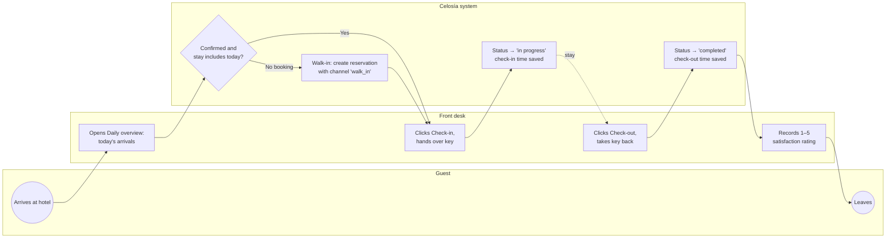
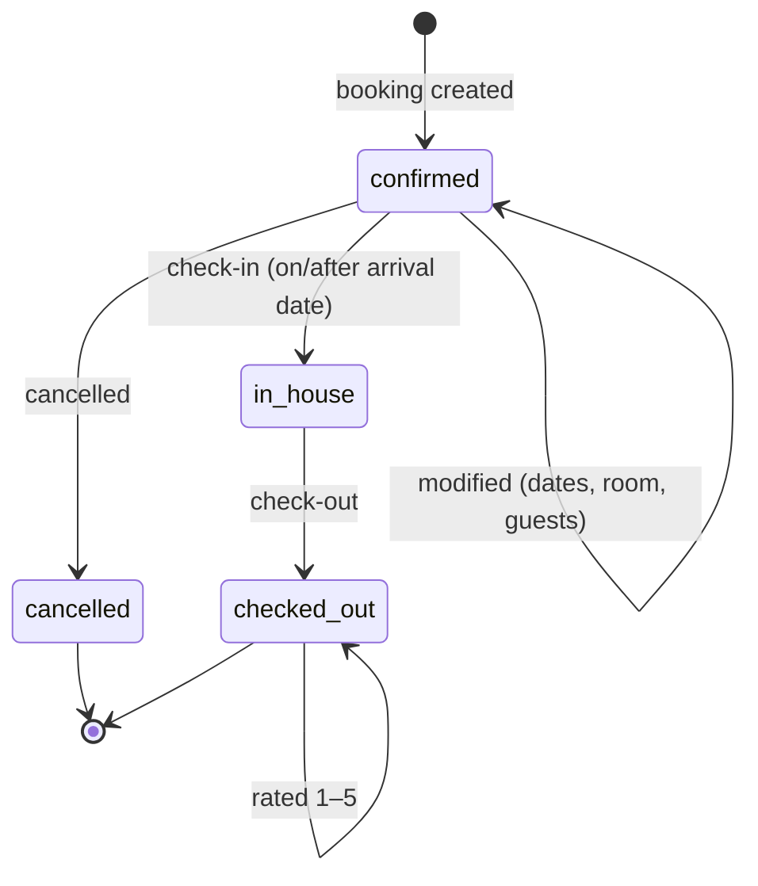

# Process Maps: As-Is and To-Be
**Project:** Celosía Hotel Reservation System · **Author:** Sara Henao Fernández

The diagrams use swimlanes, one per participant, drawn in Mermaid so GitHub renders them directly. They follow BPMN conventions: rounded boxes are tasks, diamonds are decisions, and circles are start and end events.

> The as-is processes describe a typical small hotel that runs on spreadsheets. They are assumed for this fictional case study.

---

## 1. Booking a room

### As-is: spreadsheet and WhatsApp

**Pain points**

| # | Where | Problem | Consequence |
|---|---|---|---|
| 1 | Scanning rows for free rooms | Slow, and two agents can see the same room as free at once | Double bookings |
| 2 | Calculating the price by hand | Wrong surcharge or wrong number of nights | Inconsistent quotes and revenue leakage |
| 3 | Writing guest data in a separate tab | Duplicates and typos, and no check of ID or age | No guest history, and minors can book |
| 4 | No status for each booking | Cancellations get deleted or overwritten | Cancellations can't be analyzed |
| 5 | Same treatment for every booking | No way to tell which bookings are likely to cancel | Deposits are asked of everyone or of no one, and rooms stay empty after late cancellations |

### To-be: with the Celosía system

**What changes**

| Pain point | To-be solution | Business rule / requirement |
|---|---|---|
| 1. Double bookings | Availability comes from the database, and overlapping bookings are rejected | BR-06, FR-03 |
| 2. Price errors | The price is calculated automatically and fixed at booking time | BR-10, FR-04 |
| 3. Bad guest data | One record per document, with format and age validated | BR-01–BR-03, FR-01 |
| 4. Cancellations lost | Status life cycle (confirmed, cancelled, and so on), so nothing is deleted | BR-11, FR-07 |
| 5. No way to tell which bookings will cancel | A risk level and a recommended action (for example, ask for a deposit) appear before confirming | FR-17, FR-18 |

---

## 2. Check-in and check-out

### As-is

**Pain points:**
- Arrival and departure times aren't recorded, so there's no data for staffing.
- Nobody knows for sure who is currently in the hotel.
- The spreadsheet is updated late or not at all, so rooms look occupied after the guest has left.

### To-be

**What changes:**
- The front desk sees who should arrive and leave today without searching.
- Exact check-in and check-out times are stored. They feed the arrival-pattern chart on the Performance page, which helps with staffing.
- Walk-ins are recorded as a sales channel, so management can measure them.
- Satisfaction is captured at the end of every stay.

---

## 3. Reservation life cycle

The database enforces this life cycle with CHECK constraints. For example, a reservation can't be "in progress" without a check-in time, and only completed stays can have a rating.
