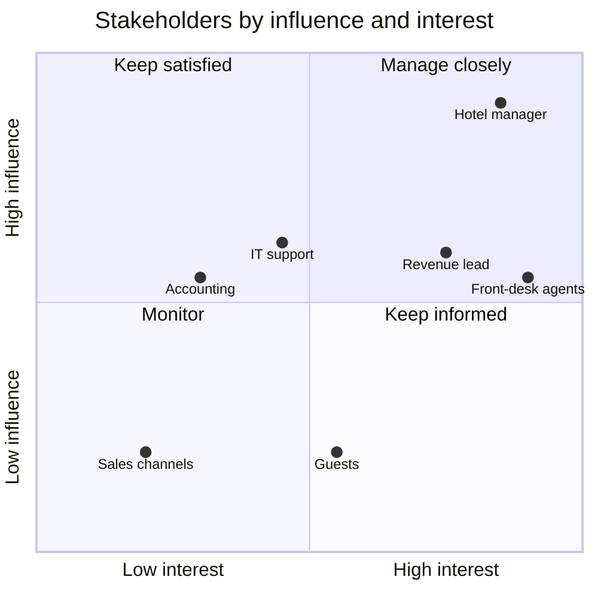

# Stakeholder Analysis
**Project:** Celosía Hotel Reservation System · **Author:** Sara Henao Fernández

> Celosía is a fictional hotel. These stakeholders represent the typical roles in a small independent hotel.

---

## 1. Stakeholder register

| Stakeholder | Role in the project | Main interests | Concerns | Influence | Interest |
|---|---|---|---|---|---|
| **Hotel manager / owner** | Sponsor and decision-maker. Owns rooms, rates and seasons | Higher occupancy and revenue, no double bookings, reliable numbers | Cost, disruption during the change | High | High |
| **Front-desk agents** | Primary daily users | Fast bookings, less manual work, fewer angry guests | Learning a new tool, being blamed for system errors | Medium | High |
| **Revenue and marketing lead** | Uses the analytics | Occupancy by season, channel mix, cancellations, satisfaction | Data quality and consistent definitions (for example, what counts as revenue) | Medium | High |
| **Guests** | Indirect users | Quick, correct quotes and a smooth check-in | Privacy of their personal data | Low | Medium |
| **IT / data support** | Hosts and maintains the system | Secure, low-cost, easy to maintain | Credentials, backups, free-tier limits | Medium | Medium |
| **Accounting** | Consumes revenue figures | Revenue that ties to what was actually charged | Revenue booked for stays that were cancelled | Medium | Low |
| **Sales channels (OTAs, travel agencies)** | External sources of bookings | Their bookings honored correctly | Commission tracking | Low | Low |

## 2. Power–interest grid

| Quadrant | Stakeholders | Engagement strategy |
|---|---|---|
| **Manage closely** | Hotel manager, front-desk agents, revenue lead | Requirements workshops, demos of each feature, final acceptance |
| **Keep satisfied** | IT support, accounting | Review security, hosting and revenue definitions before go-live |
| **Keep informed** | Guests | Clear communication about data use, faster service |
| **Monitor** | Sales channels | Make sure the channel is recorded on every booking |

## 3. RACI matrix

R = Responsible · A = Accountable · C = Consulted · I = Informed

| Activity | Business analyst | Hotel manager | Front desk | Revenue lead | IT support |
|---|---|---|---|---|---|
| Gather and document requirements | R | A | C | C | C |
| Define business rules (pricing, seasons, life cycle) | R | A | C | C | I |
| Design the data model | R | I | I | C | A |
| Build the database and app | R | I | I | I | A |
| Define KPIs and dashboards | R | A | I | C | I |
| User acceptance testing | C | A | R | R | I |
| Train front-desk staff | R | A | C | I | I |
| Deploy and secure the system | C | I | I | I | R/A |
| Maintain seasons and room status after go-live | I | A | R | C | I |

## 4. Key decisions agreed with stakeholders

| Decision | Agreed with | Why |
|---|---|---|
| One reservation = one room | Manager, front desk | Keeps availability and pricing simple. Groups book several rooms. |
| Prices are fixed at booking time and stored | Manager, accounting | If rates change later, existing bookings keep what the guest was quoted |
| Cancelled reservations are kept, not deleted | Revenue lead | Cancellations are a key metric |
| Revenue is split into "realized" (completed or in-progress stays) and "expected" (confirmed future stays) | Revenue lead, accounting | Prevents counting money that hasn't been earned yet |
| Guests, rooms and seasons with reservations can't be deleted | Manager | Protects history and reporting |
